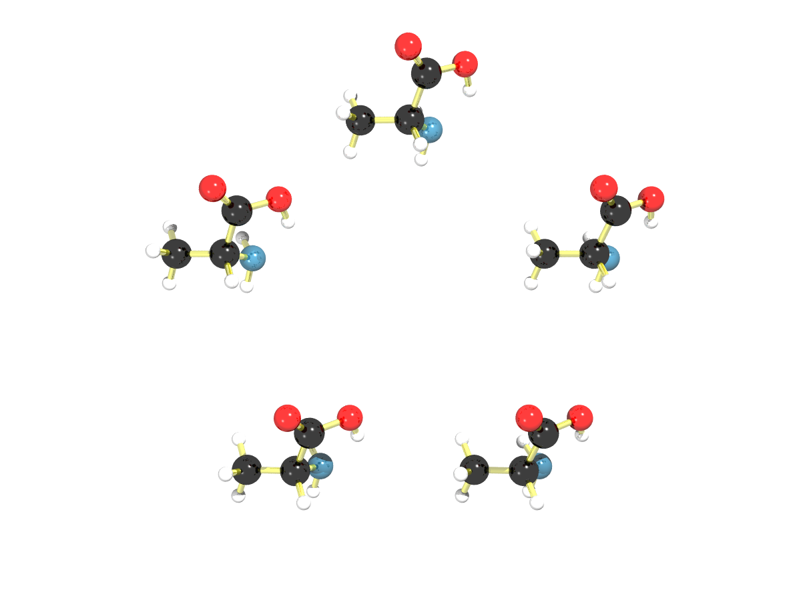

# Assignment A07: Regular Pentagon of Alanine Molecules in POV-Ray


## Prerequisites

Ensure **Git**, **Python 3**, **OpenBabel** (`obabel`), and **POV-Ray** are installed on your system:

* **Linux (Debian/Ubuntu):**
  ```bash
  sudo apt-get update
  sudo apt-get install -y git python3 python3-venv openbabel povray
  ```

* **Windows 11:**
  1. Install **Git for Windows** and **Python 3** (ensure *"Add Python to PATH"* is checked during installation), or install via `winget`:
     ```powershell
     winget install --id Git.Git -e
     winget install --id Python.Python.3.12 -e
     ```
  2. Install **OpenBabel** (from the official OpenBabel Windows release or via Conda/Miniforge) and verify `obabel` is in your system `PATH`.
  3. Install **POV-Ray for Windows (v3.7)** and ensure its `bin` directory (typically `C:\Program Files\POV-Ray\v3.7\bin`) is added to your system `PATH`.

---

## Step-by-Step Instructions

### 1. Clone the Repository and Set Up the Virtual Environment

Clone the GitHub repository, navigate into the `A07` folder, and create/activate a Python virtual environment:

* **Linux (bash/zsh):**
  ```bash
  git clone git@github.com:radek-jisa/ci2.git
  cd ci2/A07

  python3 -m venv venv
  source venv/bin/activate
  ```

* **Windows 11 (Command Prompt / cmd):**
  ```cmd
  git clone git@github.com:radek-jisa/ci2.git
  cd ci2/A07

  python -m venv venv
  venv\Scripts\activate.bat
  ```

### 2. Obtain `babel_povray3.inc` (If Not Already Present)

Download the required OpenBabel POV-Ray include file into the `A07` folder:

* **Linux:**
  ```bash
  curl -L -o babel_povray3.inc https://raw.githubusercontent.com/openbabel/openbabel/master/data/babel_povray3.inc
  ```

* **Windows 11 (PowerShell / cmd):**
  ```powershell
  curl.exe -L -o babel_povray3.inc https://raw.githubusercontent.com/openbabel/openbabel/master/data/babel_povray3.inc
  ```

### 3. Convert the `.smi` File to `.pov` Format

Run OpenBabel with the `--gen3D` switch to generate 3D coordinates and export the single alanine molecule to POV-Ray format (same command on both **Linux** and **Windows 11**):

```bash
obabel ala.smi -O ala.pov --gen3D
```

> **Important Edit to `ala.pov`:**
>
> OpenBabel automatically writes default `camera`, `light_source`, `background`, and a standalone `object { ala ... }` placement at the origin `<0, 0, 0>`. Before rendering `ala5.pov`, comment out (`//` or `/* ... */`) those default blocks inside `ala.pov`, keeping only `#include "babel_povray3.inc"` and `#declare ala = union { ... }`. This allows `ala5.pov` to control the camera, lighting, and placement of all five molecules without an extra molecule overlapping at the center.

### 4. Generate the Image with POV-Ray

Render `ala5.pov` into `ala5.png` from the command line:

* **Linux:**
  ```bash
  povray +Iala5.pov +Oala5.png +W1200 +H900 +A0.3 -D
  ```

* **Windows 11 (PowerShell / cmd):**
  On Windows, the 64-bit CLI executable is `pvengine64.exe` (passing `/EXIT` closes the POV-Ray window automatically once rendering finishes):
  ```powershell
  pvengine64.exe /EXIT +Iala5.pov +Oala5.png +W1200 +H900 +A0.3 -D
  ```
  *(If `pvengine64.exe` is not in your `PATH`, call it using its full path: `"C:\Program Files\POV-Ray\v3.7\bin\pvengine64.exe" /EXIT +Iala5.pov +Oala5.png +W1200 +H900 +A0.3 -D`.)*

---

## Rendered Result

